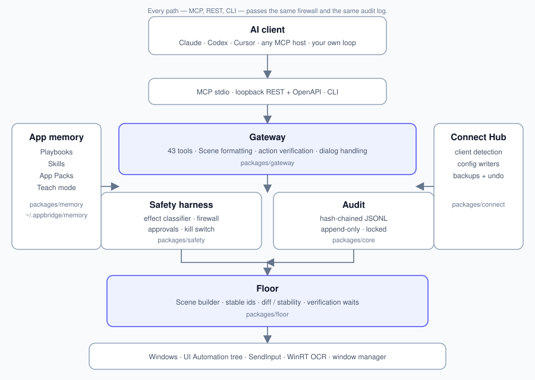

# Architecture



Appbridge is a harness, not a model. It answers three questions for any agent: *what is on
screen, did the action work, and was it allowed?* Everything else is replaceable.

## Layers

| Layer | Package | Responsibility |
|---|---|---|
| Interfaces | `gateway`, `cli` | MCP stdio, REST + OpenAPI, CLI. Thin: argument validation, formatting, transport security. |
| Gateway | `gateway/src/bridge.ts` | One method per tool. Picks a window, builds a Scene, gates an effect, acts, verifies, records. |
| Memory | `memory` | Playbooks, declarative Skills, App Packs, dialog classification. |
| Safety | `safety` | Effect classification, prompt-injection scanning, approvals, Action Firewall. |
| Core | `core` | Types, config, paths, hash-chained audit, cross-process file lock. |
| Floor | `floor` | Scene building, verification, `DeviceDriver` contract, Windows driver, native host. |

Dependencies point downward. The gateway never touches Win32; the driver never knows about
MCP. `npm run lint:universality` enforces the other rule: no app or vendor names anywhere in
`packages/`.

## Request lifecycle

```text
tool call
  → pickWindow(target)            exact title, partial title, tab lookup, or focused window
  → driver.getTree(...)           accessibility walk with depth / element caps
  → OCR (only when sparse)        untrusted text fused into the Scene
  → SceneRegistry.build(...)      stable ids, links, risk hints, digest
  → classify + gate(effect)       allow | approve | block | handoff
  → driver action                 UIA pattern first, input synthesis as fallback
  → verify                        wait for a Scene change or an explicit expectation
  → ActionResult                  {ok, class, route, verified, change, next}
  → audit.append(...)             hash-chained record with an argument digest
```

Nothing short-circuits the gate. `bridge.callTool` maps every MCP/REST tool to the same
method, so a new interface cannot bypass policy.

## The Scene contract

A Scene is the stable public view of a window. Element ids stay stable across calls within a
session, so an id returned by `screen.describe` can be used by `ui.click` after the UI
redraws — as long as the underlying accessibility element still exists. When it does not,
the action fails with `stale_element` instead of clicking somewhere else.

```jsonc
{
  "id": "s4",
  "ts": 1763000000000,
  "app": "notepad.exe",
  "window": "Untitled - Notepad",
  "window_id": "1967810",
  "focus": "e8",
  "stable": false,
  "sources": ["uia", "win32", "ocr"],
  "diff_from": "s3",
  "truncated": false,
  "warnings": [],
  "data": { "element_count": 24, "total_elements": 24, "root": null, "ocr_lines": 0 },
  "elements": [
    {
      "id": "e9",
      "role": "Edit",
      "name": "Text Editor",
      "bounds": { "x": 12, "y": 96, "width": 760, "height": 520 },
      "depth": 3,
      "parent": "e4",
      "children": [],
      "children_count": 0,
      "children_omitted": false,
      "state": { "enabled": true, "focused": true, "value": "hello" },
      "actions": ["set_value", "type", "read"],
      "risk_hint": "write",
      "conf": 0.99,
      "src": ["uia", "win32"],
      "untrusted": true
    }
  ]
}
```

Rules the builder enforces:

- **Ids are opaque and session-stable.** Do not parse them.
- **Text is data.** Anything from the app, a file, OCR or a shell is `untrusted`; injection
  heuristics add `injection_flags` and a Scene warning.
- **Partial is explicit.** `truncated`, `children_omitted` and `warnings` say what was left
  out. A depth-limited node reports `children_omitted: true` so the agent knows to drill in
  with `root`.
- **Stability is measured.** `stable` compares a content digest with the previous Scene;
  `diff_from` points at the Scene it was compared with, and is `null` when the scope changed
  (for example full window → subtree).
- **Password values never leave the host.** They are masked before the Scene exists.

## Snapshot economy

Dense apps can expose thousands of nodes; dumping them is slow and expensive. Two knobs keep
snapshots proportional to the task:

1. `max_depth` — a skeleton: top-level layout, menus, panes (typically 20–60 elements).
2. `root` — walk only one container's subtree, reusing the same stable ids.

Measured on a small utility window: a depth-2 snapshot returned 25 elements; drilling into
one pane returned 4, with ids preserved.

## Native host protocol

`packages/floor/native/uia-host.ps1` is one long-lived Windows PowerShell 5.1 process that
speaks newline-delimited JSON on stdio:

```json
{"id":"7","method":"get_tree","params":{"windowId":"1967810","maxDepth":3,"maxElements":400,"includeOffscreen":false}}
{"id":"7","ok":true,"data":{"window":{...},"elements":[...],"truncated":false,"total":41}}
```

Methods: `ping`, `list_windows`, `get_tree`, `invoke`, `set_value`, `focus_element`, `click`,
`move`, `drag`, `scroll`, `type_text`, `key`, `element_at`, `capture`, `ocr`, `ocr_languages`,
`clipboard_get`, `clipboard_set`, `process_list`, `installed_apps`, `launch_app`,
`window_action`.

Why PowerShell instead of a compiled binary:

- zero install footprint and no .NET SDK requirement,
- `Add-Type` compiles the small C# helper for `SendInput`, mouse input and DPI awareness,
- UIA objects stay in one process, so element handles are cached and fast.

Costs: startup is 1–2 s once per bridge, requests are serialized, and a hung request kills
and restarts the host. The transport is isolated in `native-host.ts`; a compiled C# or Rust
sidecar can replace it without touching the gateway. The embedded C# must stay at C# 5
syntax — Windows PowerShell's compiler rejects `out var` and newer constructs.

## Action semantics

1. **Accessibility pattern first.** `InvokePattern`, `TogglePattern`,
   `SelectionItemPattern`, `ExpandCollapsePattern`, `ValuePattern`.
2. **Input synthesis only as a fallback.** Mouse and keyboard go through `SendInput` so they
   are indistinguishable from a user's input; DPI awareness makes bounds physical pixels.
3. **Verify, always.** A click that returns without an error is not success. The verifier
   polls a fresh Scene until the digest changes or an expectation matches, then reports
   `ok`, `no_effect`, `wrong_state` or `timeout`.
4. **Never claim more than was seen.** If a value cannot be read back, `verified` is false
   and the reason says why.

## Concurrency and local state

```text
~/.appbridge/
  config.toml          policy, scene limits, filesystem roots, terminal limits
  approvals.json       pending and granted approvals (locked, atomic replace)
  audit.jsonl          append-only hash chain (locked, re-reads the true tail)
  gateway-token        bearer token for the loopback REST gateway (mode 0600)
  HALT                 kill switch
  device.json          inventory snapshot
  memory/<app>/        playbooks, skills, run history
  packs/               exported App Packs
```

Several processes can share one home: an MCP server, the CLI, and the desktop console. Both
shared stores use `withFileLock` (O_EXCL lock file with a stale-holder timeout) and re-read
the current file inside the lock, so a long-lived daemon cannot overwrite a one-shot CLI
write. The audit chain additionally verifies sequence numbers, so an interleaved write is
detected rather than silently accepted.

## Extension points

- **New platform:** implement `DeviceDriver` (`packages/floor/src/driver.ts`). Normalise
  everything inside the driver; the Scene builder stays unchanged.
- **New tool:** add a method to `Bridge`, gate its effect, register it in `mcp.ts`, document
  it in `docs/mcp-tools.md`. REST picks it up by name.
- **New skill source:** Skills are declarative data (`packages/memory/src/skills.ts`). Teach
  mode, hand-written JSON, and App Packs all feed the same compiler.
- **New perception signal:** produce elements with `src` set and `untrusted: true`; fuse
  before the Scene is built so risk and verification see one tree.
